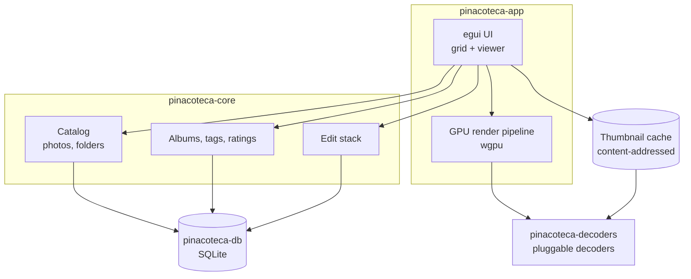

# Architecture

> Status: initial design. Details marked *(spike)* are validated in M2 with
> benchmarks before they are considered settled.

## Overview

## Crates

| Crate | Responsibility |
|-------|----------------|
| `pinacoteca-app` | Binary. Window, UI, input, GPU rendering. |
| `pinacoteca-core` | Domain model and logic: catalog, albums, tags, ratings, edit stacks. No UI, no I/O specifics. |
| `pinacoteca-decoders` | Decoder abstraction and implementations. |
| `pinacoteca-db` | SQLite persistence, schema migrations, queries. |

The dependency direction is inward: `app` depends on `core`; `core` depends on
`db` and `decoders` through traits. `core` never depends on `app` or on a UI
framework.

## Performance strategy *(spike)*

The application must stay responsive on large libraries. The strategy:

1. **Incremental indexing.** A folder scan produces a stream of photos. The grid
   renders what is known immediately and fills in as the scan progresses.
2. **Thumbnail pipeline.** Thumbnails are generated by a background worker pool
   and cached on disk, keyed by content and target size. The UI request queue is
   prioritized by what is visible.
3. **Mip pyramid for zoom.** For instant zoom and pan, the viewer uses a
   downscaled pyramid so it never needs to decode or sample the full-resolution
   image to display a fitted view.
4. **GPU rendering.** Images and thumbnails are uploaded as GPU textures and
   drawn by a custom pipeline with controllable filtering, so zoom and pan do not
   touch the CPU.
5. **Non-blocking decoding.** Full-resolution decode happens off the UI thread;
   the viewer shows the best available level until the full image is ready.

Performance budgets are measured in M2 and recorded here. Candidate budgets:

| Operation | Target |
|-----------|--------|
| Time to first thumbnails in a 10k-photo folder | < 1 s |
| Grid scroll | 60 fps |
| Viewer zoom / pan | 60 fps |
| Folder re-open (warm cache) | < 300 ms |

## Decoders *(spike)*

Decoding is behind a trait so implementations can be swapped or added without
touching the rest of the application:

- Default: pure-Rust decoders for zero-dependency distribution.
- Optional: native-backed decoders (e.g. RAW, HEIC) as separately installable
  packs.

The exact crates and the pure-Rust vs native trade-off are decided by benchmark
in M2. Candidate crates are recorded in `docs/adr/` once chosen.

## Storage

SQLite holds the catalog and all user state:

- photos and folders (indexed library),
- albums and album membership,
- tags and ratings,
- edit stacks (ordered non-destructive operations).

The original image files are treated as read-only inputs and are never rewritten.

The database location is under the user's local application data directory, e.g.
`%LOCALAPPDATA%\Pinacoteca` on Windows. The thumbnail cache lives beside it.

## Threading

- **UI thread:** egui and GPU submission only.
- **Scan threads:** filesystem traversal and metadata reading.
- **Decode pool:** thumbnail and full-resolution decoding, sized from the
  available cores.

Cross-thread communication uses channels; the UI never blocks on a worker.

## Architecture Decision Records

Decisions that carry trade-offs are recorded under `docs/adr/` (created in M2).
Each ADR states the context, the options considered, the decision and its
consequences.
