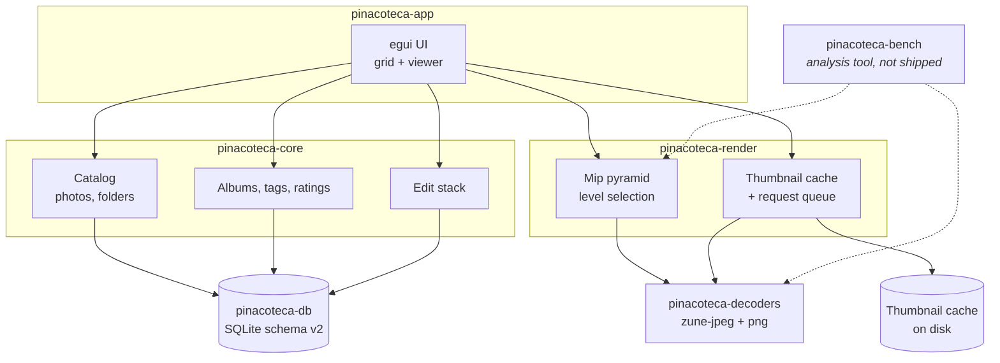

# Architecture

> Status: finalized in M2. Decisions are recorded in [`adr/`](adr/) with measured
> evidence in [`m2/`](m2/).

## Overview

## Crates

| Crate | Responsibility |
|-------|----------------|
| `pinacoteca-app` | Binary. Window, UI, input; owns the UI/GPU thread and the worker threads. |
| `pinacoteca-core` | Domain model and logic: catalog, albums, tags, ratings, edit stacks. No UI, no I/O specifics. |
| `pinacoteca-render` | Image preparation: mip pyramid and thumbnail cache / request queue. Graphics-free, headless-testable. |
| `pinacoteca-decoders` | Decoder abstraction and implementations (`zune-jpeg`, `png`; `mozjpeg` optional). |
| `pinacoteca-db` | SQLite persistence, schema migrations, queries. |
| `pinacoteca-bench` | Analysis-only benchmark harness (`publish = false`); never shipped. |

Dependency direction: `app` depends on `core`, `render`, `decoders` and `db`;
`render` depends on `decoders` (for image data); `core` and `db` are independent
leaves. `core` never depends on `app` or on a UI framework.

## Performance strategy

Settled in M2 with measurements (see [`m2/`](m2/)).

1. **Incremental indexing.** A folder scan produces a stream of photos. The grid
   renders what is known immediately and fills in as the scan progresses.
2. **Thumbnail pipeline** ([ADR-0003](adr/0003-thumbnail-cache.md)). Thumbnails
   are generated once by background workers and cached on disk in a
   content-keyed cache; the visible cells are served first through a
   deduplicating priority queue. The embedded EXIF thumbnail is used when it is
   large enough.
3. **Mip pyramid for zoom** ([ADR-0002](adr/0002-gpu-zoom-render-pipeline.md)).
   The viewer picks a pyramid level close to the on-screen size, so zoom is a
   level switch, not a re-decode or an image-wide resample.
4. **GPU rendering.** Images and thumbnails are uploaded as GPU textures and
   drawn with linear filtering, so zoom and pan do not touch the CPU.
5. **Non-blocking decoding** ([ADR-0005](adr/0005-concurrency-model.md)).
   Decoding and pyramid building run on worker threads; the viewer shows the best
   available level until the full image is ready.

### Measured unit costs

Reference machine: AMD Ryzen 9 5900X (12 cores), 32 GiB, Windows 11, `--release`.

| Operation | Measured |
|-----------|----------|
| Full JPEG decode (`zune-jpeg`) | ~64–71 ms/image (≈185–207 MP/s) |
| Full JPEG decode (`mozjpeg`, native, optional) | ~60 ms/image (≈218 MP/s) |
| PNG decode (`png`) | ~13–16 ms/image (≈260 MP/s) |
| Embedded EXIF thumbnail extract | ~0.001 ms/image (present on ~2/3 of JPEGs) |
| EXIF orientation parse | ~0.015 ms/image |
| Mip pyramid build (per photo, 6.2 levels) | ~35 ms/image; 1.33× base memory |

### Performance budgets

| Operation | Target | Status |
|-----------|--------|--------|
| Time to first thumbnails in a 10k-photo folder | < 1 s | to verify in M3 (EXIF-thumb path is ~free; the rest is `photos × 70 ms / cores`) |
| Grid scroll | 60 fps | to verify in M3 |
| Viewer zoom / pan | 60 fps | to verify in M3 (level switch is O(1), no per-frame CPU work) |
| Folder re-open (warm cache) | < 300 ms | to verify in M3 (cache hit is a disk read) |

## Decoders

Decoding is behind a trait so implementations can be swapped or added without
touching the rest of the application. See [ADR-0001](adr/0001-decoder-strategy.md).

- **Default (always built):** pure Rust — JPEG via `zune-jpeg`, PNG via `png`.
- **Optional:** native `mozjpeg` behind a cargo feature (~18% faster JPEG, needs
  a C toolchain); future RAW / HEIC packs would slot in the same way.

The benchmark that decided this is in [`m2/decoder-benchmark.md`](m2/decoder-benchmark.md).

## Storage

SQLite (schema v2, [ADR-0004](adr/0004-database-schema-v1.md)) holds the catalog
and all user state:

- folders and photos (indexed library, with dimensions, orientation, date taken),
- albums and album membership,
- tags and ratings,
- edit stacks (ordered non-destructive operations, one JSON row per op).

The original image files are treated as read-only inputs and are never rewritten.

The database lives under the user's local application data directory, e.g.
`%LOCALAPPDATA%\Pinacoteca`. The thumbnail cache ([ADR-0003](adr/0003-thumbnail-cache.md))
lives beside it as regenerable, content-keyed derived data.

## Threading

See [ADR-0005](adr/0005-concurrency-model.md). No async runtime; explicit OS
threads over `mpsc` channels.

- **UI thread:** egui and GPU submission only.
- **Scanner thread:** filesystem traversal and metadata (size, mtime, EXIF) reading.
- **Decode pool:** full-resolution decode and pyramid build, sized from the cores.
- **Thumbnail workers:** drain the priority request queue (EXIF-thumb path first).

Bounded channels provide backpressure; stale work is discarded by generation
token. The UI never blocks on a worker.

## Architecture Decision Records

Decisions that carry trade-offs are recorded under [`adr/`](adr/). Each ADR states
its context, the options considered, the decision and its consequences, with the
measurement that supports it.

| ADR | Decision |
|-----|----------|
| [0001](adr/0001-decoder-strategy.md) | Pure-Rust decoders by default; native `mozjpeg` optional |
| [0002](adr/0002-gpu-zoom-render-pipeline.md) | Lazy mip pyramid for zoom, level chosen by scale |
| [0003](adr/0003-thumbnail-cache.md) | Content-keyed thumbnail cache + deduplicating priority queue |
| [0004](adr/0004-database-schema-v1.md) | SQLite schema v2, ordered migrations, JSON edit ops |
| [0005](adr/0005-concurrency-model.md) | OS threads + channels, no async runtime |
